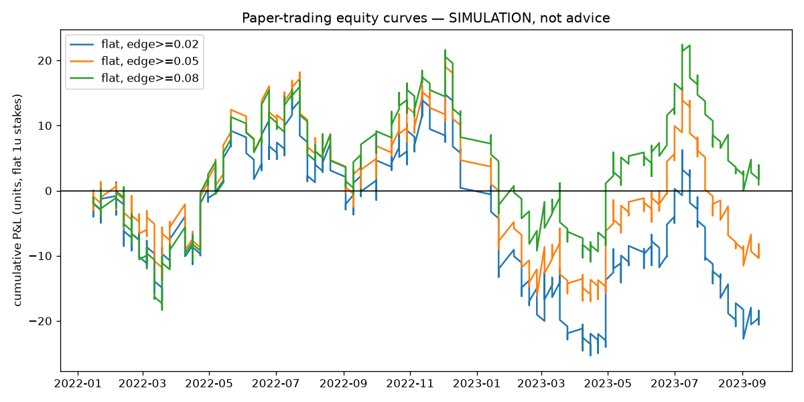

# Paper-trading backtest — validation era (2022-2023)

**THIS IS A SIMULATION for educational purposes. No real money, no betting advice. Past simulated results do not predict future returns; the odds used are best-available lines that flatter results; and the model demonstrably knows less than the market.**

Model: LR+GBM blend, walk-forward (each fight predicted by a model trained only on earlier fights). Odds: betmma best-available closing lines — a REAL bettor at one book gets worse prices than this. True CLV is not computable without opening odds; 'edge vs close' is the model's disagreement with the closing line, not captured value.

| staking | edge >= | bets | staked | P&L (u) | ROI | 95% CI | hit rate | max DD (u) | avg odds |
|---|---|---|---|---|---|---|---|---|---|
| flat | 0.02 | 621 | 621 | -20.5 | -3.3% | [-14.2%, +7.5%] | 37.7% | 42.1 | 3.15 |
| flat | 0.05 | 519 | 519 | -10.2 | -2.0% | [-14.6%, +10.8%] | 36.2% | 38.1 | 3.31 |
| flat | 0.08 | 425 | 425 | +0.9 | +0.2% | [-14.0%, +14.7%] | 34.8% | 32.5 | 3.45 |
| kelly | 0.02 | 621 | 1487 | -86.6 | -5.8% | [-20.2%, +8.6%] | 37.7% | 120.2 | 3.15 |
| kelly | 0.05 | 519 | 1517 | -85.0 | -5.6% | [-20.9%, +9.4%] | 36.2% | 128.5 | 3.31 |
| kelly | 0.08 | 425 | 1488 | -81.3 | -5.5% | [-20.9%, +11.2%] | 34.8% | 136.4 | 3.45 |

## How to read this
- A 95% CI containing 0 means the result is indistinguishable from luck.
- The M5 error analysis showed the market wins ~61% of disagreements with this model, so losses here are the expected outcome, not a bug.
- Higher edge thresholds bet less often on bigger disagreements — which are exactly the fights where the model is most likely wrong.