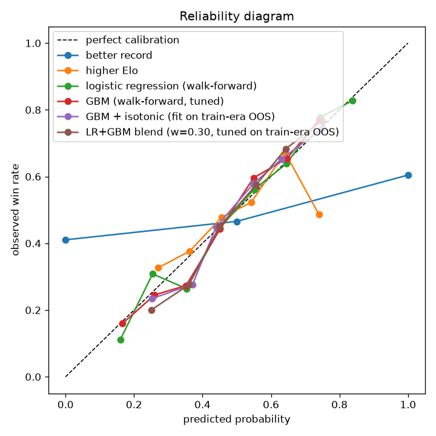

# Evaluation report — test split

Generated 2026-09-17 18:34 UTC. Fights dated (2023-12-31, 9999-12-31]. Walk-forward windows: 2024-01-01->2024-06-30, 2024-07-01->2024-12-31, 2025-01-01->2025-06-30, 2025-07-01->2025-12-31, 2026-01-01->2026-06-30, 2026-07-01->2026-09-12

| model | n | accuracy | log loss | Brier | ROC AUC | ECE | note |
|---|---|---|---|---|---|---|---|
| coin flip | 1414 | 0.5000 | 0.6931 | 0.2500 | 0.5000 | 0.0021 |  |
| better record | 1414 | 0.5859 | 9.9471 | 0.3856 | 0.5957 | 0.3610 |  |
| higher Elo | 1414 | 0.5629 | 0.6806 | 0.2437 | 0.5951 | 0.0296 |  |
| market (vig-free favorite) | - | - | - | - | - | - | no fights to score (priced fights only) |
| logistic regression (walk-forward) | 1414 | 0.6535 | 0.6259 | 0.2180 | 0.7079 | 0.0283 |  |
| GBM (walk-forward, tuned) | 1414 | 0.6521 | 0.6336 | 0.2212 | 0.6990 | 0.0346 |  |
| GBM + isotonic (fit on train-era OOS) | 1414 | 0.6482 | 0.6350 | 0.2219 | 0.6978 | 0.0319 |  |
| LR+GBM blend (w=0.30, tuned on train-era OOS) | 1414 | 0.6521 | 0.6282 | 0.2189 | 0.7076 | 0.0318 |  |

Better-record is a picking rule (0/0.5/1); its log loss is not meaningful. Compare probability metrics to the market row when it exists.

## Logistic regression — largest standardized coefficients

Positive means: the bigger fighter1's edge in this differential, the likelier fighter1 wins (per the model).

| feature | coefficient |
|---|---|
| diff_ko_end_rate_l5 | -0.506 |
| diff_dec_end_rate_l5 | -0.498 |
| diff_losses | +0.426 |
| diff_pre_ufc_sub_rate | +0.388 |
| diff_pre_ufc_ko_rate | +0.379 |
| diff_sub_end_rate_l5 | -0.353 |
| diff_avg_fight_min | +0.348 |
| diff_style_age_wrestle | +0.343 |
| diff_elo | +0.286 |
| diff_pre_ufc_finish_rate | -0.269 |
| diff_td15_l5 | +0.228 |
| diff_ko_win_rate | +0.222 |
| diff_sapm_l5 | -0.210 |
| diff_kd15_l5 | -0.210 |
| diff_age | -0.203 |

## How the fight ends (method + round)

Both models are walk-forward and scored only where they apply: the method model on every decisive fight, the round model on finishes only (a decision has no round to predict). The method model answers how the winner wins (KO / submission / decision); fight-level KO/sub/dec is that split averaged across corners, which is what the scorecard grades. The round model answers a conditional question — given that this fighter finished by this method, which round? — so its opponent is the historical round split for the same method and the same fight length.

| method of victory (how the winner wins) | n | log loss | winner's method | fight KO/sub/dec |
|---|---|---|---|---|
| method model, shrunk (production, 75% model) | 1412 | 0.9199 | 57.4% | 54.7% |
| method model, unshrunk | 1412 | 0.9174 | 57.2% | 54.5% |
| base rate (division x scheduled rounds, recent era) | 1412 | 0.9965 | 52.1% | 51.8% |

| round of finish (1-5) | n | log loss | exact round | within 1 round |
|---|---|---|---|---|
| round model, shrunk (production, 50% model) | 707 | 1.0317 | 51.5% | 81.5% |
| round model, unshrunk | 707 | 1.0317 | 50.6% | 82.5% |
| base rate (method x scheduled rounds) | 707 | 1.0443 | 51.3% | 81.8% |

Uninformed reference: guessing uniformly over 3 methods costs 1.0986; over the 3 rounds of a standard fight, 1.0986. Read both tables with the base-rate row as the bar. Finish timing is close to a coin flip weighted by 'earlier is likelier', which is why the production model is shrunk toward that base rate rather than trusted outright.

---
Favorite baseline is ~65% accuracy / ~0.62 log loss on priced fights.