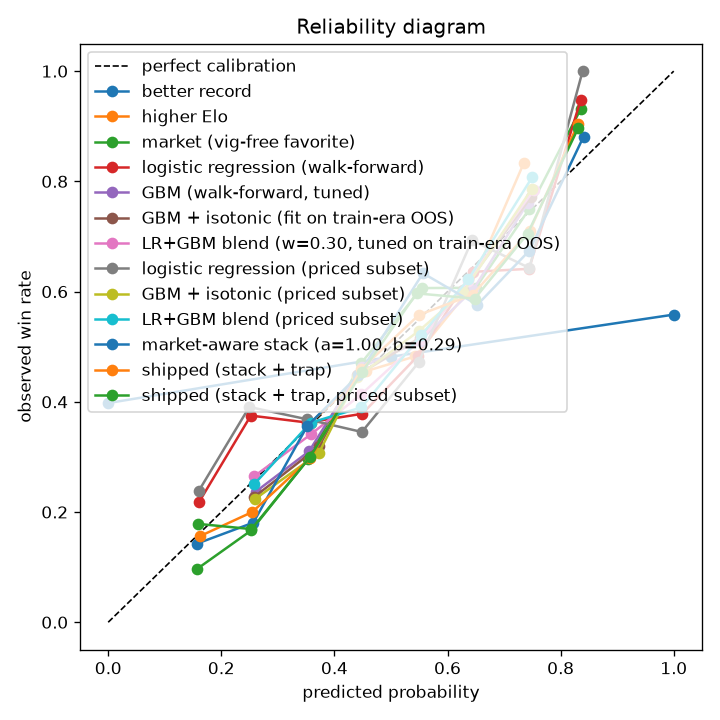

# Evaluation report — valid split

Generated 2026-09-17 18:33 UTC. Fights dated (2021-12-31, 2023-12-31]. Walk-forward windows: 2022-01-01->2022-06-30, 2022-07-01->2022-12-31, 2023-01-01->2023-06-30, 2023-07-01->2023-12-16

| model | n | accuracy | log loss | Brier | ROC AUC | ECE | note |
|---|---|---|---|---|---|---|---|
| coin flip | 1010 | 0.5000 | 0.6931 | 0.2500 | 0.5000 | 0.0208 |  |
| better record | 1010 | 0.5713 | 10.4166 | 0.4015 | 0.5794 | 0.3762 |  |
| higher Elo | 1010 | 0.5564 | 0.6806 | 0.2437 | 0.5908 | 0.0313 |  |
| market (vig-free favorite) | 697 | 0.6793 | 0.6035 | 0.2084 | 0.7344 | 0.0475 | priced fights only |
| logistic regression (walk-forward) | 1010 | 0.6178 | 0.6543 | 0.2316 | 0.6570 | 0.0593 |  |
| GBM (walk-forward, tuned) | 1010 | 0.6050 | 0.6489 | 0.2289 | 0.6650 | 0.0333 |  |
| GBM + isotonic (fit on train-era OOS) | 1010 | 0.6114 | 0.6489 | 0.2289 | 0.6645 | 0.0290 |  |
| LR+GBM blend (w=0.30, tuned on train-era OOS) | 1010 | 0.6168 | 0.6469 | 0.2280 | 0.6678 | 0.0295 |  |
| logistic regression (priced subset) | 697 | 0.6313 | 0.6503 | 0.2296 | 0.6672 | 0.0820 | same fights as market row |
| GBM + isotonic (priced subset) | 697 | 0.6162 | 0.6460 | 0.2275 | 0.6699 | 0.0286 | same fights as market row |
| LR+GBM blend (priced subset) | 697 | 0.6241 | 0.6434 | 0.2264 | 0.6743 | 0.0327 | same fights as market row |
| market-aware stack (a=1.00, b=0.29) | 697 | 0.6758 | 0.6010 | 0.2077 | 0.7347 | 0.0470 | IS the odds + residual skill — never 'beat the odds' |
| shipped (stack + trap) | 1010 | 0.6480 | 0.6221 | 0.2169 | 0.7077 | 0.0347 | predict.py market layer; no YouTube/news. 7 market-trap abstains |
| shipped (stack + trap, priced subset) | 697 | 0.6693 | 0.6075 | 0.2102 | 0.7301 | 0.0484 | same fights as market row |

Better-record is a picking rule (0/0.5/1); its log loss is not meaningful. Compare probability metrics to the market row when it exists.

## Logistic regression — largest standardized coefficients

Positive means: the bigger fighter1's edge in this differential, the likelier fighter1 wins (per the model).

| feature | coefficient |
|---|---|
| diff_ko_end_rate_l5 | -0.548 |
| diff_dec_end_rate_l5 | -0.540 |
| diff_sub_end_rate_l5 | -0.378 |
| diff_pre_ufc_fights | +0.358 |
| diff_avg_fight_min | +0.331 |
| diff_style_age_wrestle | +0.326 |
| diff_losses | +0.308 |
| diff_pre_ufc_wins | -0.283 |
| diff_strike_elo | +0.230 |
| diff_elo | +0.223 |
| diff_td15_l5 | +0.223 |
| diff_finish_involvement | +0.218 |
| diff_sub15_l5 | -0.200 |
| diff_age | -0.199 |
| diff_sapm_l5 | -0.174 |

## How the fight ends (method + round)

Both models are walk-forward and scored only where they apply: the method model on every decisive fight, the round model on finishes only (a decision has no round to predict). The method model answers how the winner wins (KO / submission / decision); fight-level KO/sub/dec is that split averaged across corners, which is what the scorecard grades. The round model answers a conditional question — given that this fighter finished by this method, which round? — so its opponent is the historical round split for the same method and the same fight length.

| method of victory (how the winner wins) | n | log loss | winner's method | fight KO/sub/dec |
|---|---|---|---|---|
| method model, shrunk (production, 75% model) | 1008 | 0.9791 | 50.9% | 50.3% |
| method model, unshrunk | 1008 | 0.9886 | 51.5% | 50.2% |
| base rate (division x scheduled rounds, recent era) | 1008 | 1.0300 | 48.5% | 48.5% |

| round of finish (1-5) | n | log loss | exact round | within 1 round |
|---|---|---|---|---|
| round model, shrunk (production, 50% model) | 530 | 1.0456 | 49.1% | 83.8% |
| round model, unshrunk | 530 | 1.0556 | 48.5% | 84.7% |
| base rate (method x scheduled rounds) | 530 | 1.0934 | 49.1% | 83.8% |

Uninformed reference: guessing uniformly over 3 methods costs 1.0986; over the 3 rounds of a standard fight, 1.0986. Read both tables with the base-rate row as the bar. Finish timing is close to a coin flip weighted by 'earlier is likelier', which is why the production model is shrunk toward that base rate rather than trusted outright.

---
Favorite baseline is ~65% accuracy / ~0.62 log loss on priced fights.