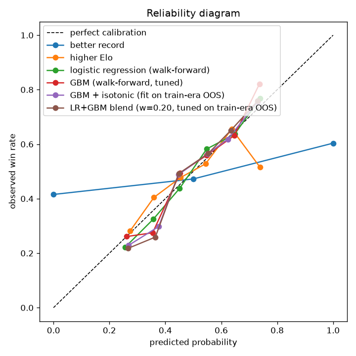

# Evaluation report — test split

Generated 2026-07-06 16:14 UTC. Fights dated (2023-12-31, 9999-12-31]. Walk-forward windows: 2024-01-01->2024-06-30, 2024-07-01->2024-12-31, 2025-01-01->2025-06-30, 2025-07-01->2025-12-31, 2026-01-01->2026-05-16

| model | n | accuracy | log loss | Brier | ROC AUC | ECE | note |
|---|---|---|---|---|---|---|---|
| coin flip | 1230 | 0.5000 | 0.6931 | 0.2500 | 0.5000 | 0.0033 |  |
| better record | 1230 | 0.5841 | 10.1356 | 0.3900 | 0.5928 | 0.3671 |  |
| higher Elo | 1230 | 0.5602 | 0.6808 | 0.2439 | 0.5908 | 0.0290 |  |
| market (vig-free favorite) | - | - | - | - | - | - | no fights to score (priced fights only) |
| logistic regression (walk-forward) | 1230 | 0.6358 | 0.6415 | 0.2252 | 0.6812 | 0.0247 |  |
| GBM (walk-forward, tuned) | 1230 | 0.6228 | 0.6424 | 0.2256 | 0.6800 | 0.0355 |  |
| GBM + isotonic (fit on train-era OOS) | 1230 | 0.6252 | 0.6433 | 0.2256 | 0.6797 | 0.0340 |  |
| LR+GBM blend (w=0.20, tuned on train-era OOS) | 1230 | 0.6285 | 0.6407 | 0.2247 | 0.6839 | 0.0410 |  |

Reading guide: 'better record' is a picking rule (0/0.5/1 outputs) — its log loss is meaningless by design; compare models on log loss / Brier / ECE against the market row, on accuracy against all rows.

## Logistic regression — largest standardized coefficients

Positive means: the bigger fighter1's edge in this differential, the likelier fighter1 wins (per the model).

| feature | coefficient |
|---|---|
| diff_elo | +0.539 |
| diff_age | -0.310 |
| diff_losses | +0.289 |
| diff_td15_l5 | +0.276 |
| diff_wins | -0.251 |
| diff_sapm_l5 | -0.237 |
| diff_td15_l3 | -0.208 |
| diff_fights_12m | +0.138 |
| diff_avg_fight_min | +0.129 |
| diff_sapm_l3 | +0.120 |
| diff_dec_win_rate | -0.118 |
| diff_slpm_l5 | +0.107 |
| diff_sig_def_l5 | +0.082 |
| diff_ctrl_pct_l3 | +0.080 |
| diff_fights_24m | +0.079 |

---
*Honest context: 'always pick the favorite' wins ~65% of priced fights and the vig-free market's log loss is ~0.62. Beating the record/Elo baselines is expected; approaching the market is the actual fight.*