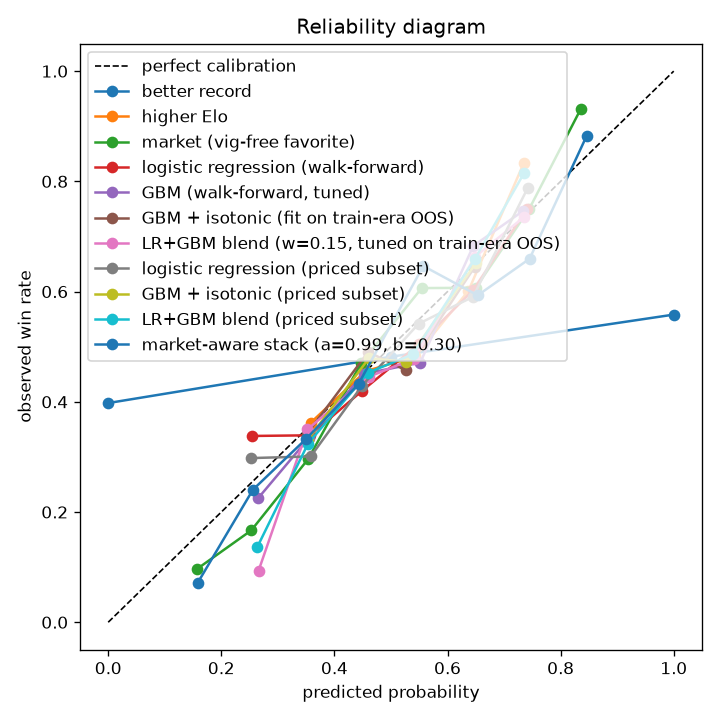

# Evaluation report — valid split

Generated 2026-07-09 00:42 UTC. Fights dated (2021-12-31, 2023-12-31]. Walk-forward windows: 2022-01-01->2022-06-30, 2022-07-01->2022-12-31, 2023-01-01->2023-06-30, 2023-07-01->2023-12-16

| model | n | accuracy | log loss | Brier | ROC AUC | ECE | note |
|---|---|---|---|---|---|---|---|
| coin flip | 1010 | 0.5000 | 0.6931 | 0.2500 | 0.5000 | 0.0208 |  |
| better record | 1010 | 0.5713 | 10.4166 | 0.4015 | 0.5794 | 0.3762 |  |
| higher Elo | 1010 | 0.5564 | 0.6806 | 0.2437 | 0.5908 | 0.0313 |  |
| market (vig-free favorite) | 697 | 0.6793 | 0.6035 | 0.2084 | 0.7344 | 0.0475 | priced fights only |
| logistic regression (walk-forward) | 1010 | 0.6109 | 0.6548 | 0.2320 | 0.6494 | 0.0369 |  |
| GBM (walk-forward, tuned) | 1010 | 0.5960 | 0.6580 | 0.2330 | 0.6472 | 0.0361 |  |
| GBM + isotonic (fit on train-era OOS) | 1010 | 0.5921 | 0.6564 | 0.2325 | 0.6465 | 0.0327 |  |
| LR+GBM blend (w=0.15, tuned on train-era OOS) | 1010 | 0.6020 | 0.6546 | 0.2317 | 0.6495 | 0.0298 |  |
| logistic regression (priced subset) | 697 | 0.6241 | 0.6497 | 0.2295 | 0.6611 | 0.0358 | same fights as market row |
| GBM + isotonic (priced subset) | 697 | 0.5983 | 0.6526 | 0.2307 | 0.6532 | 0.0315 | same fights as market row |
| LR+GBM blend (priced subset) | 697 | 0.6069 | 0.6505 | 0.2298 | 0.6566 | 0.0323 | same fights as market row |
| market-aware stack (a=0.99, b=0.30) | 697 | 0.6786 | 0.6018 | 0.2081 | 0.7329 | 0.0485 | IS the odds + residual skill — never 'beat the odds' |

Reading guide: 'better record' is a picking rule (0/0.5/1 outputs) — its log loss is meaningless by design; compare models on log loss / Brier / ECE against the market row, on accuracy against all rows.

## Logistic regression — largest standardized coefficients

Positive means: the bigger fighter1's edge in this differential, the likelier fighter1 wins (per the model).

| feature | coefficient |
|---|---|
| diff_age | -0.289 |
| diff_td15_l5 | +0.240 |
| diff_strike_elo | +0.235 |
| diff_sapm_l5 | -0.221 |
| diff_dec_win_rate | -0.203 |
| diff_td15_l3 | -0.193 |
| diff_elo | +0.188 |
| diff_fights_12m | +0.164 |
| diff_grapple_elo | +0.161 |
| diff_losses | +0.161 |
| diff_sapm_l3 | +0.146 |
| diff_n_fights | -0.138 |
| diff_ko_win_rate | -0.134 |
| diff_avg_fight_min | +0.123 |
| diff_win_pct | +0.122 |

---
*Honest context: 'always pick the favorite' wins ~65% of priced fights and the vig-free market's log loss is ~0.62. Beating the record/Elo baselines is expected; approaching the market is the actual fight.*